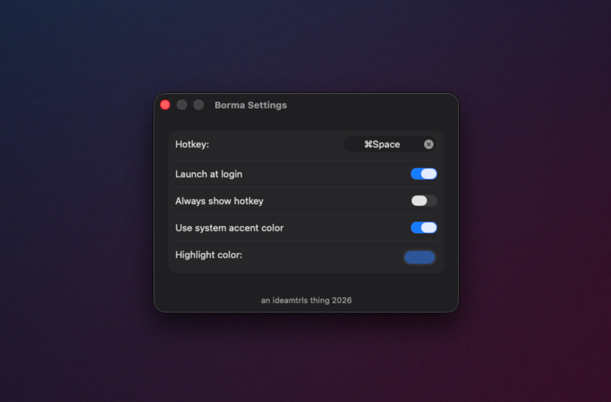

# Borma

A macOS app launcher. Press a global hotkey, type, hit return.


## What it does

Borma is a small menu bar app that summons a floating search panel from anywhere. Type a few letters of an app name and the best match opens when you hit return. Apps you launch often float to the top.

The default hotkey is Command + Shift + Space.

## Features

- Fast fuzzy search across `/Applications` and `/System/Applications` (configurable).
- Frecency ranking with a 14-day half-life so old habits fade.
- Live updates when apps are installed or removed.
- Detects a Spotlight conflict on Command + Space and falls back automatically.
- Headless. No Dock icon, just a menu bar item.

## Settings



Open with the menu bar icon or Command + Comma. Rebind the hotkey, toggle launch at login, pick a highlight color.

## Build

Borma uses [xcodegen](https://github.com/yonaskolb/XcodeGen).

```bash
brew install xcodegen
xcodegen generate
open Borma.xcodeproj
```

Set your dev team in Signing and Capabilities, then Command + R. See `Memory/build.md` for details.

## Configuration

Stored in `~/Library/Application Support/com.ideamtrls.borma/`:

- `config.json`: search paths, highlight color, UI toggles.
- `frecency.json`: launch history.
